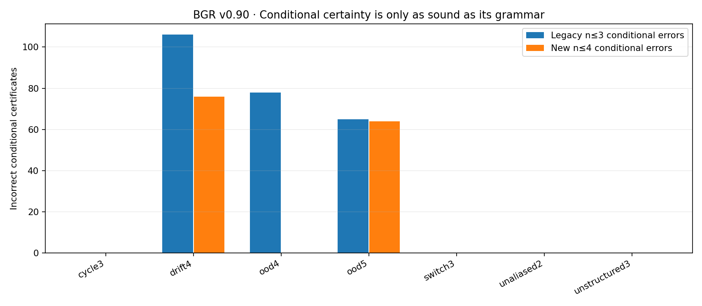

# BITWORK — Geometric Reasoning v0.90.0

**Long-term objective: General Intelligence**  
**Present research contribution:** exact finite-prefix constraint inference for hidden causal machines with up to four states, independently checked predictive-state minimization, and an explicit boundary between model-conditional and externally justified knowledge.  
**Status:** bounded finite-state research checkpoint. **Not AGI.**

> **The scientific turning point:** v0.89 incorrectly certified 261 observations in four-state environments outside its three-state hypothesis family. In v0.90's new held-out cohort, the *same prior three-state implementation* made **78 false conditional certificates** on 72 four-state cases; the expanded four-state symbolic support solver made **zero**. However, it still made **140 false conditional certificates** in five-state or nonstationary stress worlds. We cannot make those errors disappear by assuming our largest enumerated model is always correct.

**No language model or language subsystem has been added. Only Bitwork/BGR was changed.** BitWatts electrical measurement remains deferred.

## Contents

[Research question](#research-question) · [New abilities](#new-abilities) · [Frozen results](#frozen-results) · [Run and verify](#run-and-verify) · [Directory](#full-directory) · [Limits and future](#scientific-limits-and-future)

## Research question

How can a learner reason over hidden action/observation dynamics beyond the original enumerated finite grammar without claiming that its current grammar is universally adequate? How can it collapse redundant hidden states *only when every future action sequence preserves predictions*?

Bitwork v0.90 addresses these **separate** questions with two algorithms and an explicit scope gate. The teacher emits **two anonymous nullable binary sensor channels** after each of two actions; no true latent labels or hidden state count are supplied to the learner.

## New abilities

1. **Symbolic four-state expansion** (`bgr90/symbolic.py`): represent only states and transition/emission constraints actually reached by the observation history, naming hidden states in order of first appearance. Unknown edges/emissions remain free. No complete catalog of 16,777,216 labeled four-state machines is built. Fully enumerated n=1/2 reference experiments and independent replay validate next-observation *support*, not calibrated Bayesian probabilities.
2. **Evidence-preserving expansion**: contradictions or exhausted work budgets make the learner abstain. Original observations remain durable in memory and can be replayed with a higher model-state or row budget; scope attestation is revoked on expansion.
3. **Explicit model adequacy boundary** (`bgr90/adequacy.py`): distinguish model-conditional unanimity from an outward-facing certificate. In the study, no externally validated grammar attestation is supplied. Public certifications are therefore **always withheld**, even if the candidate set agrees. This conservative refusal prevents unsupported public assertions; **it does not automatically detect all out-of-family worlds**.
4. **Exact minimal predictive-state quotient** (`bgr90/quotient.py`): standard finite Moore automaton partition refinement merges two fully specified reachable hidden states **only** when all possible future action sequences produce the same sensor outputs. Verified against brute-force distinguishability words and hidden-state label permutations. No claim to infer the minimal quotient directly from limited real-world observations.
5. **Constructive finite-data impossibility witness** (`scripts/open_world_counterexample.py`): after any finite masked observation history, two larger causal machines can agree with every observation and disagree on the next output. Thus no universally sound next-output certificate exists without a bound or external assumption on possible worlds.

## Frozen results

Study `BGR-090-OPEN-SCOPE-AND-PREDICTIVE-QUOTIENT-001`: **7 task families × 24 unseen worlds × 3 sensor-mask rates** = **504 cases** and **22,176 original action observations**. All support sets and conditional certificates were reconstructed by a separately written Python reference. The benchmark compares the original frozen v0.89 three-state controller to the new four-state support with the same observations.

| Test family | Cases | Old three-state false conditional certificates | New four-state false conditional certificates | Public certificates (unattested) |
| --- | ---: | ---: | ---: | ---: |
| Three-state / two-state in-grammar families | 288 | 0 | 0 | 0 |
| **Four-state, formerly out-of-family** | **72** | **78** | **0** | **0** |
| Five-state, still outside grammar | 72 | 65 | 64 | 0 |
| Changing-rule four-state worlds | 72 | 106 | 76 | 0 |
| **All families** | **504** | **249** | **140** | **0** |

**New in-family soundness passed. Universal model-family adequacy did not.** Zero public certifications are the result of refusing to grant scope attestation, not of learning to identify all possible invalid models. Conditional mistakes in the five-state and nonstationary experiments are preserved and visible.

The expanded four-state model remained consistent in all 72 four-state cases, while the legacy three-state learner rejected evidence in **71/72**. Four-state examples needed at most **2,997 partial hypothesis rows** in this cohort, versus a catalog of 16,777,216 complete labeled four-state machines. Those quantities count different representations and do not establish an exact memory-speedup factor.

The complete-machine predictive quotient was independently verified on **120 reference worlds**, and **17** had fewer predictively distinct states than nominal hidden-state labels.

The descriptive paired bootstrap over 24 four-state world seeds (mask repetitions clustered) estimates **68–88 fewer false conditional certificates** for the new model over this fixed cohort design (unadjusted 95% interval). This is not a guarantee outside the finite grammar.

### Audit and reproducibility

- The reference replayed all **22,176 action observations** and reconstructed all **6,103 conditional certificates**, including all **140** deliberately out-of-family failures.
- Source and original study are SHA-256 frozen; a full second run matched **all 504 scientific case records**.
- **Preserved reporting defect:** the original `SCIENTIFIC.json` projection mistakenly retained top-level `total_elapsed_informational`. The raw reproduced files therefore had different hashes. After excluding that one timing field, every scientific datum matched exactly. Both the failed precheck and corrected normalization are retained in `results/`—the learner and held-out seed cohort were not altered.
- The historical `BGR-v0.89.0.zip` is included unchanged and hash-verified.



## Run and verify

Requirements: Python 3.11+, NumPy 1.24+. Matplotlib and Playwright are **optional** developer-only tools for rebuilding included plots and browser acceptance. No GPU, internet service, language API or model weights are required.

Windows (from the extracted root):

```powershell
python -m pip install -r requirements.txt
.\BGR-All-One.ps1 -Action Verify
.\BGR-All-One.ps1 -Action Demo
.\BGR-All-One.ps1 -Action UI
```

Read-only evidence viewer: `http://127.0.0.1:8078/ui/`. **Native Windows execution has not been tested in this environment.**

Cross-platform:

```bash
python -m unittest discover -s tests -v
python -m scripts.verify_release
python -m experiments.independent_audit --results-dir results/study-001
python -m scripts.open_world_counterexample
python -m scripts.demo
python -m http.server 8078 --bind 127.0.0.1
```

To rerun without overwriting frozen results:

```bash
python -m experiments.run_study --output runs/reproduction-001
python -m experiments.independent_audit --results-dir runs/reproduction-001
```

## Full directory

| Path | Contents |
| --- | --- |
| `bgr90/symbolic.py` | Four-state symbolic support, evidence preservation, contradiction and resource-safe replay |
| `bgr90/adequacy.py` | Three-state probability model plus four-state conditional support and external-scope gate |
| `bgr90/quotient.py` | Exact complete-machine predictive equivalence and canonical minimal quotient |
| `bgr90/worlds.py` | **Evaluator-only** five-state and changing-rule stress worlds |
| `bgr90/evaluation.py` | Source-frozen no-reset masked-observation study |
| `bgr60/` through `bgr89/` | Prior core algorithms, finite-world research and compatibility source |
| `baseline/BGR-v0.89.0.zip` | Original complete predecessor release with its historical archive lineage |
| `experiments/PLAN.json` | Frozen seed blocks, masks, scientific promotion gates and limitations |
| `experiments/SOURCE_FREEZE.json` | SHA-256 fingerprints of all frozen study source and inherited tests |
| `experiments/v90_independent_reference.py` | Separate non-vectorized path-constraint filter and future-word equivalence checker |
| `experiments/independent_audit.py` | Independent replay and complete-machine quotient audit |
| `experiments/run_study.py` | Frozen evaluation runner and sealed JSON scientific records |
| `experiments/independent_reference.py`, `v89_independent_reference.py`, `v86_independent_audit.py` | Preserved original regression references used by previous tests |
| `results/study-001/` | Original study trace, scientific projection, seals and independent audit |
| `results/REPRODUCIBILITY*.json` | Successful matched rerun and preserved timing-field export precheck failure |
| `results/PAIRED_ANALYSIS.json` | World-clustered unadjusted descriptive uncertainty estimates |
| `results/GATES.json` | Explicit passed, failed and untested scientific gates |
| `results/RESEARCH_LEDGER.jsonl` | Local hash-linked research receipts, not external signatures |
| `scripts/open_world_counterexample.py` | Constructive arbitrary-finite-history indistinguishability test |
| `tests/test90.py`, `tests/test90_limit.py` | New model support, quotient, safety, exactness and impossibility tests |
| `tests/test85.py` through `tests/test89.py` | Preserved historical regression tests |
| `assets/` | Frozen-study statistical charts and browser acceptance screenshot |
| `ui/` | Read-only browser viewer using real recorded observations |
| `docs/` | BitWatts, claim boundaries, experiment protocol, file directory |
| `WHITEPAPER.md`, `NEXT_ITERATION.md`, `AGENT_CONTEXT.md` | Formal argument, next scientific roadmap, continuation instructions |
| `BGR-All-One.ps1` | One root-anchored PowerShell entry for tests, demo, UI and reproduction |

## Scientific limits and future

This learner does **not** discover arbitrary causal world grammars, handle stochastic models exactly, prove it knows the true hidden-state bound, independently validate model-scope attestations, or achieve positive transfer across fully new perception modalities. The transfer result from v0.88 remains a separate experiment; it was **not** merged into the v0.90 hidden-model learner or revalidated under changing emissions.

The public scope gate protects downstream certainty by **abstaining without attestation**. When a user-supplied laboratory flag is set, the model remains conditionally sound only if the attested assumption is *actually true*—a Boolean flag is not secure validation.

The next research priority is adaptive model-family invention and validation under stochastic/delayed dynamics, using the smallest predictive representation consistent with observed data, and then independent task environments. [NEXT_ITERATION.md](NEXT_ITERATION.md) has a specific falsifiable plan.

**BitWatts:** candidate rows and transitions examined are measured. Physical watts and joules remain unmeasured and intentionally deferred. Software version `0.90.0` is **not** “90% of AGI.”
